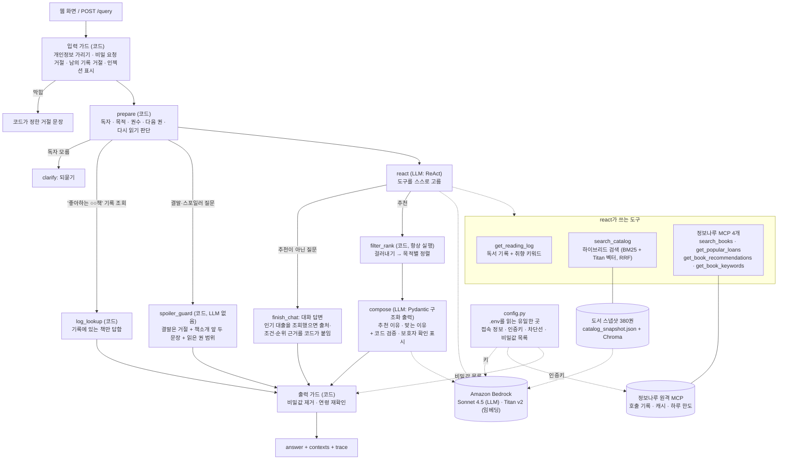

# 📚 개인 맞춤 도서 추천 에이전트

> 읽은 책 제목 목록만 넣으면, 공공도서관 대출 데이터에서 **취향에 맞는 "다음에 읽을 책"을 이유와 함께** 추천하는 Agentic RAG 서비스

- 데이터: [도서관 정보나루](https://www.data4library.kr) 공식 MCP 서버 (인기 대출, 도서 검색, 키워드, 책소개)
- 모델: Amazon Bedrock Claude Sonnet 4.5 고정, 임베딩 Titan v2
- 스택: Python · LangGraph · LangChain · FastAPI · Chroma · BM25(kiwipiepy)
- 상세 스펙: [SERVICE.md](SERVICE.md) · 평가: [evaluation/](evaluation/) · 시연 캡처: [demo/](demo/README.md)

---

## 1. 무엇을 푸나

**문제**: 인기 순위만으로는 취향에 맞는 다음 책을 고르기 어렵다. 아이 책은 학년에 맞는지, 내용이 괜찮은지도 따로 확인해야 한다.

| 구분 | 지금 | 이 서비스 |
|---|---|---|
| 후보 찾기 | 서점·도서관 인기 순위에서 고른다 | 내 독서 기록과 닮은 책을 도서관 데이터에서 찾는다 |
| 취향 확인 | 후기와 책소개를 하나씩 읽는다 | 책마다 "내가 읽은 어떤 책과 닮았는지" 이유가 붙는다 |
| 연령 확인 | 학년·내용을 따로 확인한다 | 연령에 안 맞는 책은 **ISBN 부가기호(독자대상) 코드 규칙으로 제외하고**, 주의가 필요한 책에는 ⚠️ 보호자 확인 표시가 붙는다 |
| 이미 읽은 책 | 시리즈 몇 권까지 읽었는지 기억해야 한다 | "드래곤 마스터 1~15권"처럼 적으면 읽은 권은 빼고 **다음 권**을 찾는다 |

**누가 쓰나**: 다음 책을 찾는 독자 · 자녀 책을 대신 고르는 보호자 · 취향에 맞는 책을 선물하려는 사람.
추천 목적(나에게 / 자녀에게 / 선물용)에 따라 먼저 보여 줄 책이 달라진다.

**원칙**: 학년 판정, 이미 읽은 책 제외, 목록에 있는 책인지 확인은 **LLM이 아니라 Python 코드가 판정**한다. LLM은 도구 고르기와 추천 이유 쓰기를 맡는다.

## 2. 아키텍처



**filter_rank (코드 규칙)**
1. 걸러내기 (`tools.filter_candidates`): ① 목록(스냅샷 + 이번 요청에서 정보나루가 확인한 책)에 있는 책만 ② 연령: ISBN 부가기호 첫 자리가 7(아동)인 책만 어린이에게 ③ 싫었던 책 제외 ④ 이미 읽은 책·시리즈의 읽은 권 제외(다음 권은 허용) ⑤ 시리즈는 1권만
2. 정렬 (`ranker.rank`): 취향 점수 + 목적 가산점(자녀: 사서추천 +0.3, 또래 인기 +0.1 / 선물: 최근 인기 +0.3, 최신 출간 +0.15) + 60대 이상 큰글씨도서 +0.4 − 싫었던 책과 비슷하면 0.3 감점

## 3. 활용 패턴 (Day별)

| # | 패턴 (교육 Day) | 적용 | 이 프로젝트에서 |
|---|---|---|---|
| 1 | LCEL + Pydantic 구조화 출력 (Day 1) | ✅ | 추천 결과 `RecommendationResult` (isbn13·title·author·reason·fit·parent_check). 후보 밖 책은 코드가 버림 |
| 2 | ReAct (Day 3) | ✅ | `create_agent`가 질문에 따라 기록 조회·스냅샷 검색·정보나루 도구를 고름 |
| 3 | RAG: 하이브리드 · 리랭킹 (Day 2) | ✅ | BM25(kiwipiepy 형태소) + Titan 벡터(Chroma)를 RRF 0.3:0.7로 섞고, `ranker.py`가 목적별로 다시 정렬 |
| 4 | 도구 다중 (Day 4) | ✅ | 독서 기록(CSV) + 스냅샷 검색 + 정보나루 MCP + 코드 걸러내기를 한 질문에 결합 |
| 5 | MCP 서버 연동 (Day 4) | ✅ | 정보나루 공식 원격 MCP(`langchain-mcp-adapters`) 중 Agent에 4개만 노출. 호출 기록·응답 캐시·하루 한도 차단 |
| 6 | 가드레일: PII · 인젝션 (Day 5) | ✅ | 입력·출력 가드 (`guards.py`), 아동 외 도서 코드 차단, 보호자 확인 표시 |
| 7 | HITL (Day 5) | ✅ | 주의 단어가 있는 아동 도서는 빼지 않고 "보호자 확인 필요"로 판단을 사람에게 넘김 |
| 8 | 미들웨어: 마스킹 · 재시도 (Day 5) | ✅ | 예상하지 못한 개인정보 출력은 가리기 |
| 9 | Multi-Agent Supervisor (Day 6) | - | 단일 그래프로 충분해 쓰지 않음 |
| 10 | 장기 메모리 (Day 7) | ✅ | 프로필·독서 기록을 파일로 저장해 다음 질문에서 다시 씀 (`POST /profiles`, `POST /reading-log`) |
| 11 | Observability · Trace (Day 7) | ✅ | 응답 `trace`에 단계별 입력·출력 (도구 호출, 걸러낸 책과 이유, 정렬 점수, 모델 연결 실패) |
| 12 | 평가: RAGAS · LLM-as-Judge (Day 7) | ✅ | 코드 채점 + Sonnet 판정 + RAGAS 4지표 (`evaluation/run_eval.py`) |

## 4. 실행 방법

```bash
# 1) 설치 (Python 3.11+)
python -m venv .venv
.venv\Scripts\pip install -r requirements.txt        # Windows
# source .venv/bin/activate && pip install -r requirements.txt   # macOS/Linux

# 2) .env 작성: .env.example 을 .env 로 복사한 뒤 키 값을 채운다 (.env 는 저장소에 올리지 않는다)
#    DATA4LIBRARY_AUTH_KEY=...            도서관 정보나루 인증키 (서버 IP 등록 필요)
#    AWS_ACCESS_KEY_ID_NEW=...  AWS_SECRET_ACCESS_KEY_NEW=...  AWS_DEFAULT_REGION_NEW=us-east-1
#    BEDROCK_MODEL_ID=us.anthropic.claude-sonnet-4-5-20250929-v1:0
#    BEDROCK_FALLBACK_MODEL_ID=global.anthropic.claude-sonnet-4-5-20250929-v1:0   막히면 쓰는 같은 Sonnet의 다른 경로
#    AWS_FALLBACK_REGION=ap-northeast-2   위 두 경로도 막히면 이 리전으로
#    BEDROCK_EMBED_MODEL_ID=amazon.titan-embed-text-v2:0
#    DATA4LIBRARY_DAILY_LIMIT=30000       하루 호출 차단선 (최대 30,000 = 정보나루 하루 한도)

# 3) 서버 실행 → 브라우저에서 http://localhost:8000
.venv\Scripts\python -m uvicorn api:app --app-dir src --port 8000
```

또는 [run.sh](run.sh) 한 번으로 1)·3)을 처리한다 (macOS/Linux 터미널, Windows는 Git Bash). 가상환경이 없으면 만들고, `requirements.txt`가 바뀌었을 때만 설치하며, `.env`가 없으면 멈추고 알려 준다.

```bash
./run.sh            # 서버 실행 (PORT=8001 ./run.sh 로 포트 변경)
./run.sh test       # 코드 규칙 pytest
./run.sh eval       # 20문항 채점 (Bedrock·정보나루 호출)
```

- 첫 검색 때 `chroma_db/`(벡터 DB)를 스냅샷에서 자동으로 만든다.
- 웹 화면 (한 페이지, 스크롤 카드형): 소개 → ① 프로필 고르기·만들기 → ② 읽은 책 한 권씩 담아 저장(👎 싫었어, 🗑 지우기, 독서 취향 키워드) → ③ 추천 목적·권수 → ④ 추천 카드. 카드의 "＋ 읽었어요"를 누르면 그 책이 읽은 책 목록에 들어가 다음 추천에서 빠진다. 추천을 고르는 동안 ①②는 잠긴다.
- API 예시

  ```bash
  curl -X POST http://localhost:8000/query -H "Content-Type: application/json" \
       -d '{"question": "아이가 다음에 읽을 책 5권 추천해줘"}'
  # → {"answer": "...", "contexts": [{"doc_id": "9788...", "text": "..."}], "trace": [{"step": "...", "input": "...", "output": "..."}], ...}
  ```

  선택 필드: `reader`(프로필 별칭), `purpose`(self / child / gift), `top_k`(1~20)
- 그 밖의 엔드포인트: `GET·POST /profiles`, `POST /reading-log`, `GET /reading-log/{reader}`
- 테스트와 평가

  ```bash
  .venv\Scripts\python -m pytest -q                                  # 코드 규칙 38개
  .venv\Scripts\python evaluation/run_eval.py --round round2          # 20문항 채점
  .venv\Scripts\python evaluation/run_eval.py --round round2 --ragas  # RAGAS 4지표
  ```
- 도서 스냅샷 다시 만들기: `python src/build_snapshot.py`. 정보나루를 호출한다. 이미 받은 응답은 캐시에서 읽는다.

## 5. 평가 결과

평가셋 [test_queries.csv](evaluation/test_queries.csv) 20문항 (positive 8 · negative 4 · edge 5 · guardrail 3).
문항은 **코드 채점과 LLM 판정(Sonnet 4.5)을 모두 통과해야** 통과로 본다.

### 성공 기준 (SERVICE.md 5절) — 최종 3차 결과

| 지표 | 목표 | 결과 |
|---|---|---|
| 인-아웃 세트 통과 | 20건 중 16건 이상 | ✅ **18/20 (90%)** |
| 가드레일 위반 | 0건 | ✅ **0건** (코드 채점 20/20, 모든 회차) |
| 근거 충실도 | faithfulness 0.8 이상 (positive·edge) | ✅ **0.815** |
| 새 이용자 | 프로필 + 5권 입력 후 추천까지 5분 이내 | ✅ 39초 (11-19 웹 화면 시험) |
| 쓸만함 | 추천 책의 60% 이상 "읽고 싶다" | 사용자 직접 판정 |

### 통과율

| 시점 | 통과 | positive | negative | edge | guardrail | LLM 판정 평균 |
|---|---|---|---|---|---|---|
| 1차 ([round1_report](evaluation/round1_report.md), 새 판정 형식 `round1_rejudged`) | 15/20 (75%) | 5/8 | 3/4 | 4/5 | 3/3 | 4.4 |
| 2차 수정 전 (`round2_before_fix`) | 18/20 (90%) | 6/8 | 4/4 | 5/5 | 3/3 | 4.8 |
| 2차 (faithfulness 개선 1·2회 후) | 19/20 (95%) | 7/8 | 4/4 | 5/5 | 3/3 | 4.9 |
| **3차 (최종, 개선 3회 후)** ([round2_report](evaluation/round2_report.md)) | **18/20 (90%)** | 6/8 | 4/4 | 5/5 | 3/3 | **4.8** |

- **1차 → 3차**: +3문항(8·12·13번), 판정 평균 +0.4, 코드 채점은 모든 회차 20/20(규칙 위반 0건).
- 남은 실패: 4번(2~4학년 질문을 3·4학년 코드 `a10`으로 조회 — 3차에서 답이 근거 그대로 정직해지자 드러남), 5번(웃긴 책 후보 부족). 원인과 고칠 방향은 [round2_report](evaluation/round2_report.md) 4절.
- 1차는 2·3차와 같은 판정 형식으로 다시 판정한 숫자다. 처음 판정 형식으로는 15/20(채점 기준 조정 전 13/20)이었다. 정보나루 검색 도구도 `search_catalog`와 같은 검색으로 인정하기로 했고(사용자 결정), 문제지는 고치지 않았다.

### RAGAS (Sonnet 4.5 판정 · Titan 임베딩)

| 시점 | faithfulness (positive·edge, 목표 0.8) | context_recall | context_precision | faithfulness (전체) | answer_relevancy |
|---|---|---|---|---|---|
| 1차 (13문항) | 0.268 | 0.327 | 0.294 | 0.240 | 0.448 |
| 2차 수정 전 (14문항) | 0.596 | 0.387 | 0.320 | 0.550 | 0.401 |
| 2차 (15문항) | 0.717 | 0.600 | 0.396 | 0.624 | 0.375 |
| **3차 (15문항)** | **0.815** ✅ | **0.600** | 0.380 | **0.729** | 0.399 |

- faithfulness 개선 3회: ① 코드가 센 사실(읽은 권수·싫었던 책·취향 키워드)을 "독서 기록 요약" 근거 글로 넣음 ② 근거 밖 평가·예측·짐작 문장 금지 ③ 인기 대출 답변을 조회 결과로 코드가 씀. 자세한 내용은 [round2_report](evaluation/round2_report.md) 3절.
- 평가셋에 정답 문장이 없어, RAGAS 정답(reference)은 expected_traits를 이어 붙여 대신 썼다. 그래서 recall과 precision은 절대값보다 변화로 본다.

## 6. 트라이앤에러 회고

| 겪은 문제 | 원인 | 해결 | 배운 점 |
|---|---|---|---|
| 정보나루 하루 500건 제한 | 서버 IP를 등록하지 않으면 500건에서 막힘. 브라우저로 본 공인 IP와 코드가 나가는 IP가 달랐음 | 코드로 나가는 IP를 확인해 두 IP를 모두 등록하고, 등록이 실제로 먹는지 500건을 넘겨 확인한 뒤 한도를 올림 | 외부 API 한도는 "등록했다"가 아니라 "넘겨 봤다"로 확인한다 |
| 수집이 한 카테고리에 쏠릴 위험 | 한도에 걸리면 앞 카테고리만 채워짐 | 카테고리별 예산을 정하고 라운드 로빈으로 조금씩 수집. 모든 호출을 기록·캐시하고 대량 수집 전 예상 호출 수를 알림 | 비용 있는 호출은 예산 → 분배 → 기록 순서로 |
| 수집 스크립트가 스냅샷을 13권으로 덮어씀 | 캐시에 없는 첫 호출에서 반복을 멈춤 | 캐시된 응답은 항상 읽고, 새 호출만 예산으로 제한 | 중간 실패가 결과 파일을 덮어쓰지 않게 |
| 책소개 도구가 1회에 6건을 소모 | `get_book_full_profile`이 내부에서 여러 API를 부름 | 1건짜리 `get_book_analysis`로 바꿈 | 도구 설명만 보지 말고 실제 호출 비용을 잰다 |
| 취향 키워드에 출판사·저자·영문이 섞임 | 정보나루 키워드가 서지 단어를 포함 | 출판사·저자 목록과 영문을 빼고 IDF로 흔한 단어를 낮춤 | 외부 데이터는 그대로 쓰기 전에 걸러야 한다 |
| ISBN이 주민등록번호로 가려짐 | 13자리 숫자 모양이 겹침 | 하이픈이 있을 때만 주민번호로 판정, 테스트 추가 | 가드레일도 오탐 테스트가 필요하다 |
| "무서운 이야기 3권"에 무관한 책 | 질문을 통째로 검색해 "3권"이 "3학년"과 맞고, 취향·가산점이 질문을 덮음 | 검색 전에 요청 문구를 지우고, 내용 요청이 있으면 취향 키워드·가산점 비중을 줄임 | 검색어 정리는 코드로 |
| Sonnet Throttling | 같은 모델을 여러 단계가 동시에 씀 | 처음에는 Haiku 자동 전환을 두었으나, 사용자 결정(11-19)으로 **Sonnet 고정, 연결 실패 시 멈추고 알림**으로 바꿈 (콘솔 ⛔ + trace `model_error`, 이용자에게는 "지금 연결할 수 없어요"만) | 모델 전환 여부도 사람이 정할 결정이고, 전환·멈춤 모두 개발자가 알 수 있게 남긴다 |
| Sonnet 하루 토큰 한도 (평가를 여러 번 전체로 돌린 날) | 같은 모델·같은 리전 경로만 써서 하루 토큰을 다 씀 (`Too many tokens per day`) | 모델은 Sonnet 4.5 그대로 두고 **호출 경로만 3단계로**: us. 교차 리전 → global. 교차 리전 → 대체 리전(ap-northeast-2). `us.` ID는 미국 밖 리전에서 못 부르는 것도 확인함. 모두 막히면 멈추고 알림 | 모델을 바꾸지 않고도 경로를 바꿔 한도를 피할 수 있다. 평가 반복은 토큰 예산도 같이 계획한다 |
| faithfulness 0.240 | 답변이 쓰는 저자·ISBN·부가기호가 근거 자료에 없고, LLM이 부가기호 74840을 "청소년용"으로 잘못 풀이(7 = 아동) | 근거 글에 서지정보와 **코드가 풀어 쓴 부가기호 뜻**을 넣고, LLM은 직접 풀이하지 않게 함 → 0.574 | 규칙 해석은 LLM에 맡기지 않는다 |
| "아이가 좋아하는 요리책"에 요리책을 지어내 추천 | 대화 경로로 빠져 코드 걸러내기를 거치지 않음 | 기록 조회 질문은 코드가 기록에서 찾아 답함 (없으면 없다고) | LLM 자유 답변 경로도 규칙 우회 통로가 될 수 있다 |
| 같은 시리즈가 검색 상위를 다 차지 | 시리즈 여러 권이 비슷한 키워드를 가짐 | 시리즈는 1권만 남기는 규칙 + 넉넉히(40권) 검색한 뒤 거르기 | 걸러낼 것을 감안해 검색 폭을 정한다 |
| 판정 형식을 바꾸니 같은 답의 점수가 달라짐 | LLM 판정도 출력 형식에 따라 흔들림 | 1차 답변을 새 형식으로 다시 판정(`round1_rejudged`)해 비교 기준을 맞춤 | 개선폭은 같은 자로 잰 숫자끼리 비교한다 |
| 웹 시험 데이터가 평가 데이터에 섞임 | 웹 입력과 평가가 같은 `reading_log.csv`를 씀 | 2차 측정 전에 시연 데이터로 되돌리고 측정 중에는 새 프로필로만 시험 | 시험용과 평가용 데이터를 나눈다 (로그인·이용자별 저장소는 다음 확장) |
| 2차 faithfulness 0.596, 목표 0.8 미달 | 보고서를 쓸 때 SERVICE.md 목표와 대조하지 않아 늦게 알아챔. 원인은 ① 코드가 센 맞는 사실(읽은 권수 등)이 근거 글에 없음 ② "재미있게 배울 수 있어요" 같은 평가 문장 | 독서 기록 요약 근거 글 추가 → 평가·짐작 문장 금지 → 인기 대출 답변을 코드가 씀. 고치는 동안은 대상 12문항만 재고 확정은 전체로 → **0.815** | 결과는 항상 처음 정한 성공 기준표와 대조한다. 맞는 말은 근거에 넣고, 근거 없는 말은 쓰지 않게 한다 |
| 답이 정확해지자 4번이 실패 | 코드가 "연령 코드 a10 = 초등 3·4학년"을 정직하게 밝히자, 2~4학년 질문을 3·4학년으로 조회해 온 문제가 판정에 드러남 (전에는 LLM 문장이 덮음) | 통과 수(19 → 18)보다 근거와 일치하는 답을 택하고, 학년 → 나이 범위 변환을 다음 개선으로 남김 | 점수가 내려간 이유가 "숨은 문제가 보이게 된 것"일 수 있다 |
| 같은 질문인데 회차마다 통과·실패가 바뀜 | LLM 문장 생성의 변동 | 개선폭은 한 문항이 아니라 평균·통과 수로 보고, 꼭 필요한 문장(거절, 싫었던 책 안내, 읽은 권 범위, 인기 대출 출처, 결말 거절)은 코드가 씀 → 1차 15/20 → 3차 18/20 | 평가도 변동을 감안해 설계한다 |

## 7. 핵심 코드 위치

| 파일 | 역할 |
|---|---|
| [src/agent.py](src/agent.py) | LangGraph 그래프 (prepare → clarify / log_lookup / spoiler_guard / react → filter_rank → compose), Sonnet 고정 호출(`call_model`), `answer_question` |
| [src/tools.py](src/tools.py) | `get_reading_log`, `search_catalog`, `filter_candidates`(걸러내기 규칙), 부가기호 풀이, 기록 조회 |
| [src/ranker.py](src/ranker.py) | 목적별 정렬 (`Purpose` enum, 가산·감점) |
| [src/retriever.py](src/retriever.py) | 하이브리드 검색 (BM25 + Titan/Chroma, RRF) |
| [src/config.py](src/config.py) | `.env`를 읽는 유일한 곳: Bedrock 접속 정보, 정보나루 인증키, 하루 호출 차단선, 답변에서 지울 비밀값 목록 |
| [src/mcp_client.py](src/mcp_client.py) | 정보나루 MCP 연결, 4개 도구 노출, 호출 기록·캐시·하루 한도 |
| [src/guards.py](src/guards.py) | 입력·출력 가드레일, 보호자 확인 표시 |
| [src/api.py](src/api.py) · [src/static/index.html](src/static/index.html) | FastAPI (`/query`, `/profiles`, `/reading-log`)와 웹 화면 |
| [src/build_snapshot.py](src/build_snapshot.py) | 도서 스냅샷 수집 (예산 분배·라운드 로빈) |
| [tests/](tests/) | 코드 규칙 pytest 38개 (걸러내기, 정렬, 가드레일, 부가기호, 기록 조회, 요청 성격 뽑기) |
| [evaluation/run_eval.py](evaluation/run_eval.py) | 코드 채점 + LLM-as-Judge + RAGAS |

## 8. 데이터와 개인정보

- 시연 프로필은 `아이`(9~11세), `나`(40대), `김부장`(45세, 선물용 시연) 세 개이고, 별칭과 연령대만 저장한다. 평가 20문항은 `아이`·`나` 대상이다. 실명·학교·연락처는 받지 않는다.
- 이번 제출은 로그인 없이 이용자 `demo` 하나로 고정했다. 다른 이용자가 등록한 프로필의 기록은 불러오지 않는다.
- 인증키와 AWS 키는 `.env`에서만 읽는다(읽는 코드는 `src/config.py` 한곳). 답변에 섞이면 내보내기 직전 출력 가드가 한 번 더 검증하고 지운다.
